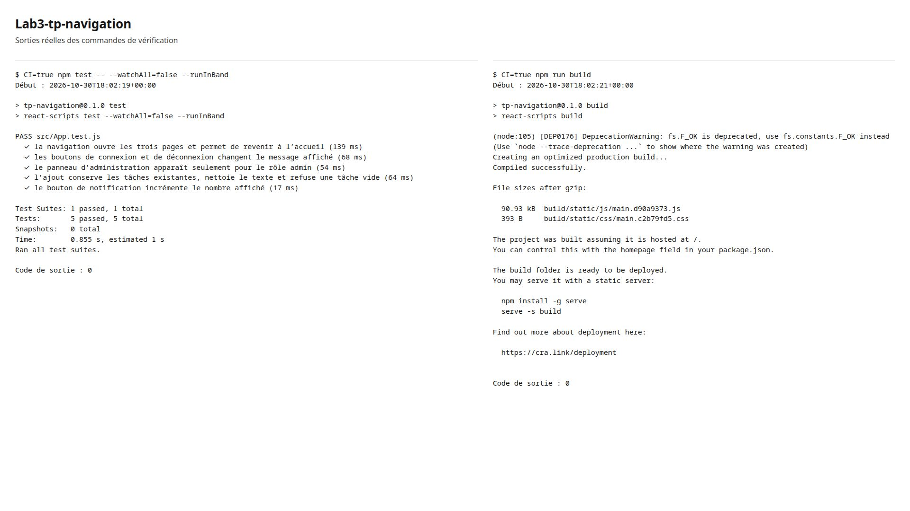
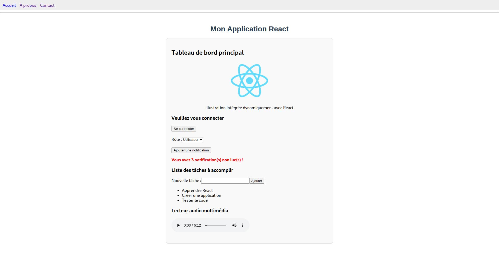
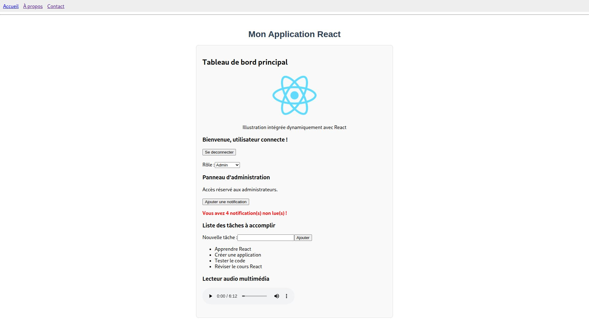
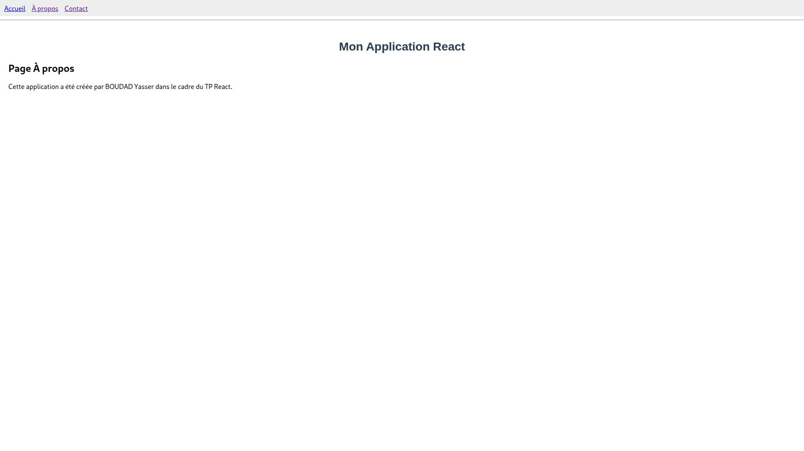
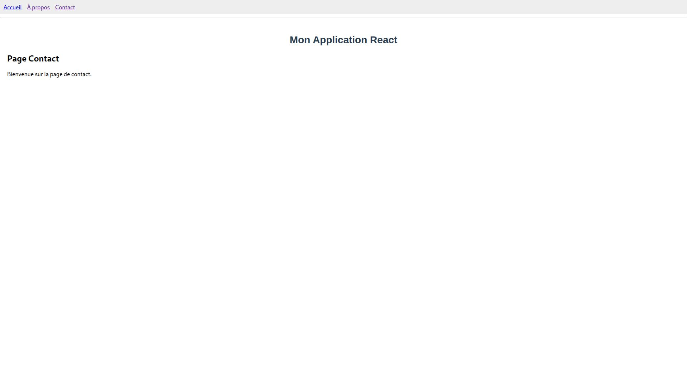
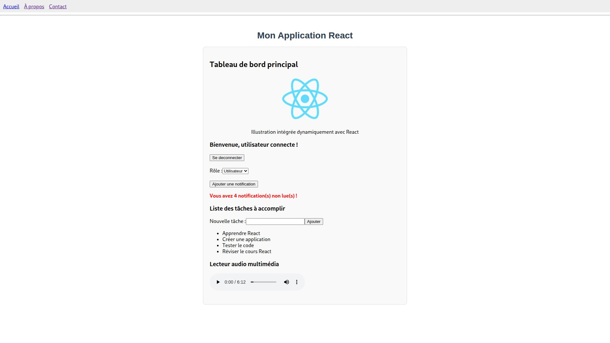

# Lab3-tp-navigation

**Réalisé par : BOUDAD Yasser**

Navigation entre Accueil, À propos et Contact, avec logo et lecteur audio.

Installation et lancement depuis le dossier du projet :

```bash
npm ci
npm start
```

Ouvrir l’URL indiquée dans le terminal, généralement `http://localhost:3000`.

Vérifications :

```bash
CI=true npm test -- --watchAll=false --runInBand
npm run build
```

Résultats :

```text
Test Suites: 1 passed, 1 total
Tests:       5 passed, 5 total
Build:       Compiled successfully.
```

Les tests vérifient la navigation entre les trois pages, la connexion et la déconnexion,
l’affichage du panneau selon le rôle, l’ajout d’une tâche et le refus d’un texte vide,
ainsi que le passage de trois à quatre notifications.

Sorties des commandes de tests et de build :



Dans le navigateur, la navigation, la connexion et la déconnexion, les rôles,
les notifications et l’ajout d’une tâche ont été vérifiés. Le logo est chargé
et la lecture audio démarre, progresse et peut être mise en pause.

Captures de l’application :



Utilisateur connecté avec le rôle Admin, quatre notifications et la tâche « Réviser le cours React » ajoutée.







Avec le rôle Utilisateur, le panneau d’administration est masqué.


